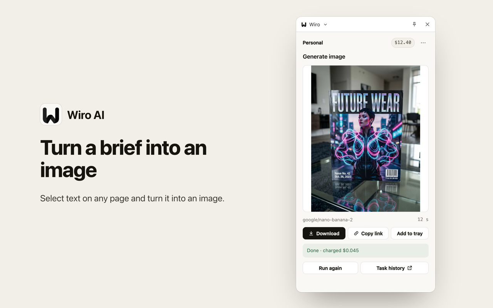
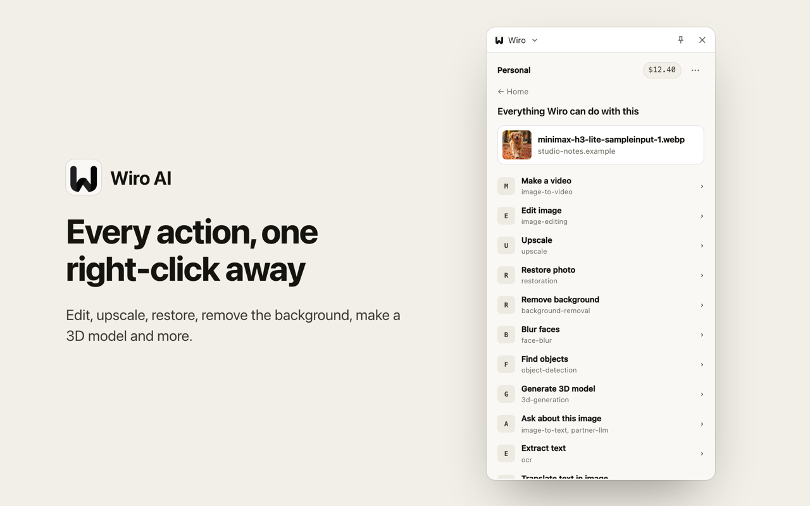
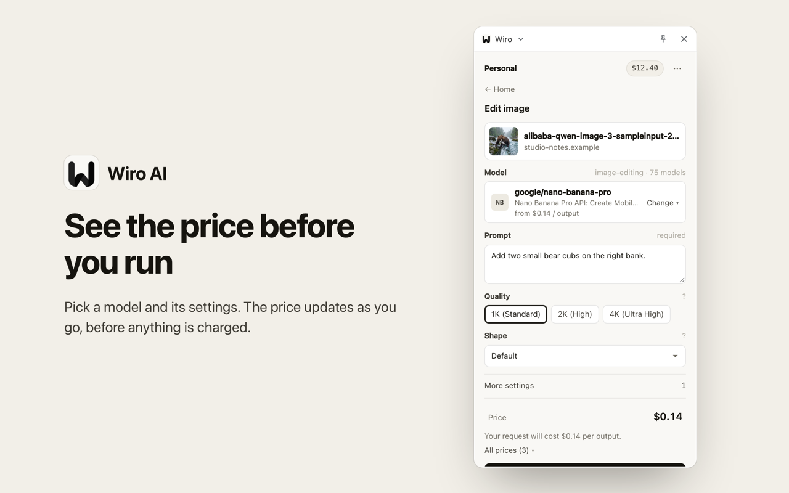

<div align="center">


# Wiro AI Add-on for Firefox

Right-click any image, video, audio clip, text or page to run Wiro AI models in Firefox's sidebar: make a video, edit or upscale an image, restore a photo, read text aloud, transcribe, translate and more, with the price shown before every run.

[](./manifest.json) [](#build) [](./tsconfig.json) [](./LICENSE)

[Website](https://wiro.ai) · [Models](https://wiro.ai/models) · [Docs](https://wiro.ai/docs) · [Dashboard](https://wiro.ai/panel)


</div>

Wiro puts its AI models one right-click away. Pick what you want done with an image, a video, an audio clip, selected text or the page, choose a model from the live Wiro catalog, and the result comes back in the sidebar next to the page. You sign in with your Wiro account, runs are paid from your Wiro wallet, and the sidebar shows the price before you start.

<p align="center">
  
  
</p>
<p align="center">
  
  
</p>
<p align="center">
  
  
</p>
<p align="center">
  
  
</p>
<p align="center">
  
  
</p>

## What you can do

| Right-click on | Actions |
| --- | --- |
| An image | make a video, edit with a prompt, upscale, restore an old photo, remove the background, blur faces, find objects, make a 3D model, ask about it, extract or translate its text, make a product ad, add effects, make a song from it, make it talk, try clothes on |
| A video | edit with a prompt, upscale, add music, ask about it |
| An audio clip | transcribe it, change the voice |
| Selected text | generate an image or a video, read it aloud, turn it into a song, translate it, summarize it |
| A page | turn it into a video with Wiro Studio, ask about it |

Each action lists the Wiro models made for it, so new models show up without an add-on update. Sort them by price, popularity or date and pick one; the sidebar asks only for what that model needs.

## Install

The store link will appear here once the listing is live on addons.mozilla.org. To try it now, build it from source (below), open `about:debugging#/runtime/this-firefox`, choose **Load Temporary Add-on** and pick `dist/manifest.json`.

## Build

Requirements: macOS or Linux, Node.js 22 or newer (built with 22.16.0) and npm 10 or newer. The build bundles the TypeScript and Preact sources with esbuild (no minifying); `package-lock.json` pins every dependency.

From a source archive, skip the clone and run the remaining steps in its root. From git:

```bash
git clone --recurse-submodules https://github.com/wiroai/Wiro-Firefox-Extension.git
cd Wiro-Firefox-Extension
npm install
(cd core && npm install)
npm run typecheck
npm run build
npm run lint
```

The add-on is then in `dist/`; `npm run package` zips it into `web-ext-artifacts/`.

After a core change: `git -C core pull origin main`, rebuild, and commit the new `core` pointer.

## How it is built

The shared code (sign-in, MCP client, actions, model gateway, pricing and the panel UI) lives in [Wiro-Extension-Core](https://github.com/wiroai/Wiro-Extension-Core), included here as the `core/` submodule. This repo adds the Firefox parts:

- `src/platform.ts`: storage, the sign-in window (`browser.identity.launchWebAuthFlow`) and tabs.
- `src/background.ts`: the background page. It builds the right-click menus and opens the sidebar on a click; the toolbar button toggles the sidebar.
- `src/panel.ts`, `public/panel.html`: the sidebar page.
- `manifest.json`: Manifest V3 with `sidebar_action`, desktop Firefox 140 and later.

## Sign-in

Sign-in uses the Wiro OAuth server at `mcp.wiro.ai` (PKCE, no API key in the browser). Firefox catches the loopback redirect `http://127.0.0.1/mozoauth2/<id>`, where `<id>` comes from `identity.getRedirectURL()`.

## Notes for the addons.mozilla.org review

```bash
npm run package
```

This writes the zip to `web-ext-artifacts/`. The bundle is made with esbuild, so the review also gets the source: this repo with the `core/` submodule checked out, `package-lock.json` included, and the build steps above.

- `browser_specific_settings.gecko.id` is `extension@wiro.ai`; it keeps the add-on ID the same across builds.
- `data_collection_permissions` declares `websiteContent`: when the user starts a run, the clicked item's address or the selected text goes to Wiro.
- The linter warns about `innerHTML` in the bundle. It is Preact's support for `dangerouslySetInnerHTML`, which this add-on never uses.
- The linter also notes that Firefox for Android reads `data_collection_permissions` from version 142. The add-on is for desktop Firefox, since Android has no sidebar.

## Permissions

| Permission | Why |
| --- | --- |
| `menus` | the Wiro entries in the right-click menu |
| `storage` | the sign-in tokens, the tray, run history and the last model picked per action |
| `identity` | the Wiro sign-in window |

No host permissions and no content scripts: the add-on reads only what a right-click hands it (the item's address, the selected text or the page address) and sends it to Wiro when you start a run. See the [Wiro privacy policy](https://wiro.ai/agreement/privacy-policy).

## More from Wiro AI

| Repository | What it is |
| --- | --- |
| [Wiro-Chromium-Extension](https://github.com/wiroai/Wiro-Chromium-Extension) | Wiro AI extension for Chrome, Edge, Opera, Whale and Brave |
| [Wiro-Safari-Extension](https://github.com/wiroai/Wiro-Safari-Extension) | Wiro AI extension for Safari on the Mac |
| [Wiro-Extension-Core](https://github.com/wiroai/Wiro-Extension-Core) | Shared core of the Wiro AI browser extensions |
| [Wiro-MCP](https://github.com/wiroai/Wiro-MCP) | Official MCP server for Wiro AI, [`@wiro-ai/wiro-mcp` on npm](https://www.npmjs.com/package/@wiro-ai/wiro-mcp) |
| [Wiro-Plugin](https://github.com/wiroai/Wiro-Plugin) | Wiro AI plugin for Cursor, Claude Code, Gemini CLI and Devin |
| [Wiro-LLM](https://github.com/wiroai/Wiro-LLM) | Wiro AI provider for the Vercel AI SDK |
| [Swift-QuickStart](https://github.com/wiroai/Swift-QuickStart) | WiroKit, the Wiro AI SDK for iOS |
| [Kotlin-QuickStart](https://github.com/wiroai/Kotlin-QuickStart) | WiroKit, the Wiro AI SDK for Android |
| [Dart-QuickStart](https://github.com/wiroai/Dart-QuickStart) | Wiro AI SDK for Dart and Flutter, [`wiro` on pub.dev](https://pub.dev/packages/wiro) |
| [ReactNative-QuickStart](https://github.com/wiroai/ReactNative-QuickStart) | Wiro AI SDK for React Native and Expo, [`@wiro-ai/wiro-react-native` on npm](https://www.npmjs.com/package/@wiro-ai/wiro-react-native) |
| [Swift-Realtime](https://github.com/wiroai/Swift-Realtime) | Realtime voice AI example for iOS |
| [Kotlin-Realtime](https://github.com/wiroai/Kotlin-Realtime) | Realtime voice AI example for Android |
| [Dart-Realtime](https://github.com/wiroai/Dart-Realtime) | Realtime voice AI example for Flutter |
| [ReactNative-Realtime](https://github.com/wiroai/ReactNative-Realtime) | Realtime voice AI example for React Native |
| [n8n-nodes-wiroai](https://github.com/wiroai/n8n-nodes-wiroai) | Wiro AI nodes for n8n, [`@wiro-ai/n8n-nodes-wiroai` on npm](https://www.npmjs.com/package/@wiro-ai/n8n-nodes-wiroai) |
| [Wiro-Dify-Plugin](https://github.com/wiroai/Wiro-Dify-Plugin) | Wiro AI plugins for Dify: the LLM gateway as a model provider, plus image, video, speech and music tools |
| [Wiro-ComfyUI](https://github.com/wiroai/Wiro-ComfyUI) | Wiro AI nodes for ComfyUI |
| [hermes-wiro-provider](https://github.com/wiroai/hermes-wiro-provider) | Wiro AI model provider plugin for Hermes Agent |
| [Wiro-Zed](https://github.com/wiroai/Wiro-Zed) | Wiro AI MCP server extension for Zed |
| [wiro-action](https://github.com/wiroai/wiro-action) | GitHub Action for Wiro AI models and the LLM gateway, [on the GitHub Marketplace](https://github.com/marketplace/actions/wiro-ai-action) |
| [Wiro-Docs](https://github.com/wiroai/Wiro-Docs) | Source of the Wiro AI API docs |

[Website](https://wiro.ai) · [Models](https://wiro.ai/models) · [Docs](https://wiro.ai/docs) · [X](https://x.com/wiroai)

## License

MIT, see [LICENSE](./LICENSE).
